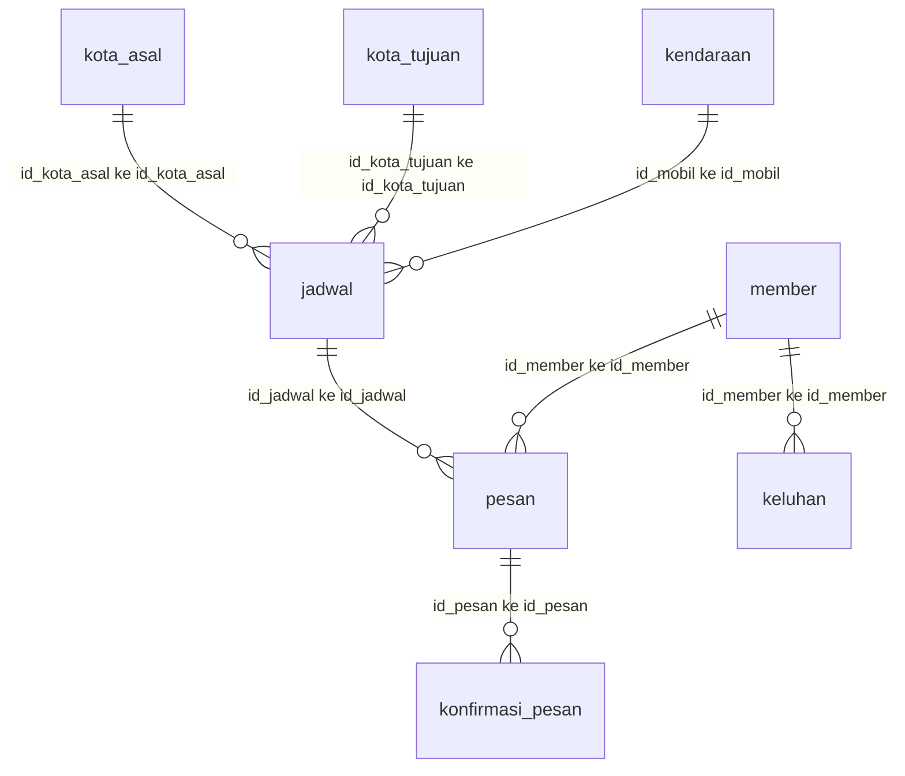

# Design Database — Sistem Pemesanan Tiket Travel

> Sumber: `db_tiket.sql` (database `db_tiket2`, dump phpMyAdmin 11 Oktober 2017; MySQL 5.6.26). Dokumen ini menggambarkan struktur **yang benar-benar ada** pada SQL dan memisahkan saran perubahan.

## 1. Gambaran Umum

Database mendukung pengelolaan pengguna (admin, operator loket, member), kendaraan, kota asal dan tujuan, jadwal keberangkatan, pemesanan kursi, konfirmasi pembayaran melalui transfer, dan keluhan member.

**Jumlah tabel: 10.** Semua tabel memakai InnoDB dan `DEFAULT CHARSET=latin1`. Semua kolom yang dideklarasikan pada tabel sumber bersifat `NOT NULL`.

## 2. Daftar Entitas

| Tabel | Fungsi |
|---|---|
| `admin` | Akun administrator pengelola sistem. |
| `jadwal` | Jadwal keberangkatan beserta rute, tarif, dan kendaraan. |
| `keluhan` | Keluhan yang dikirim member. |
| `kendaraan` | Data kendaraan yang digunakan untuk perjalanan. |
| `konfirmasi_pesan` | Konfirmasi transfer pembayaran untuk pemesanan. |
| `kota_asal` | Referensi lokasi keberangkatan. |
| `kota_tujuan` | Referensi lokasi tujuan. |
| `member` | Akun pelanggan pemesan tiket. |
| `operator_loket` | Akun petugas loket. |
| `pesan` | Pemesanan kursi pada jadwal tertentu. |

## 3. Skema Tabel (Sesuai SQL Sumber)

Keterangan: **PK** = primary key; **AI** = auto increment; **Relasi logis** = kolom yang tampak merujuk tabel lain tetapi **tidak** memiliki constraint `FOREIGN KEY` pada dump.

### 3.1 `admin`

Akun administrator pengelola sistem.

| Kolom | Tipe data | Keterangan |
|---|---|---|
| `id_admin` | `int(11)` | PK, AI, NOT NULL |
| `email` | `varchar(50)` | NOT NULL |
| `password` | `varchar(50)` | NOT NULL |
| `no_telp` | `varchar(20)` | NOT NULL |
| `nama_lengkap` | `varchar(100)` | NOT NULL |

### 3.2 `jadwal`

Jadwal keberangkatan beserta rute, tarif, dan kendaraan.

| Kolom | Tipe data | Keterangan |
|---|---|---|
| `id_jadwal` | `int(11)` | PK, AI, NOT NULL |
| `id_kota_asal` | `int(11)` | Relasi logis, NOT NULL |
| `id_kota_tujuan` | `int(11)` | Relasi logis, NOT NULL |
| `harga` | `int(11)` | NOT NULL |
| `tgl_berangkat` | `date` | NOT NULL |
| `jam_berangkat` | `time` | NOT NULL |
| `id_mobil` | `int(11)` | Relasi logis, NOT NULL |

### 3.3 `keluhan`

Keluhan yang dikirim member.

| Kolom | Tipe data | Keterangan |
|---|---|---|
| `id_keluhan` | `int(11)` | PK, AI, NOT NULL |
| `id_member` | `int(11)` | Relasi logis, NOT NULL |
| `j_keluhan` | `varchar(20)` | NOT NULL |
| `d_keluhan` | `varchar(200)` | NOT NULL |

### 3.4 `kendaraan`

Data kendaraan yang digunakan untuk perjalanan.

| Kolom | Tipe data | Keterangan |
|---|---|---|
| `id_mobil` | `int(11)` | PK, AI, NOT NULL |
| `jenis_mobil` | `varchar(20)` | NOT NULL |
| `nomor_polisi` | `varchar(20)` | NOT NULL |
| `warna_mobil` | `varchar(20)` | NOT NULL |

### 3.5 `konfirmasi_pesan`

Konfirmasi transfer pembayaran untuk pemesanan.

| Kolom | Tipe data | Keterangan |
|---|---|---|
| `no_resi` | `varchar(20)` | PK, NOT NULL |
| `no_rek` | `int(20)` | NOT NULL |
| `tgl_transfer` | `date` | NOT NULL |
| `jam_transfer` | `time` | NOT NULL |
| `id_pesan` | `int(11)` | Relasi logis, NOT NULL |

Catatan: `no_resi` adalah PK berbentuk teks; `no_rek` bertipe `INT(20)` pada sumber, bukan tipe teks.

### 3.6 `kota_asal`

Referensi lokasi keberangkatan.

| Kolom | Tipe data | Keterangan |
|---|---|---|
| `id_kota_asal` | `int(11)` | PK, AI, NOT NULL |
| `nm_kota_asal` | `varchar(27)` | NOT NULL |

### 3.7 `kota_tujuan`

Referensi lokasi tujuan.

| Kolom | Tipe data | Keterangan |
|---|---|---|
| `id_kota_tujuan` | `int(11)` | PK, AI, NOT NULL |
| `nm_kota_tujuan` | `varchar(26)` | NOT NULL |

### 3.8 `member`

Akun pelanggan pemesan tiket.

| Kolom | Tipe data | Keterangan |
|---|---|---|
| `id_member` | `int(11)` | PK, AI, NOT NULL |
| `nama` | `varchar(100)` | NOT NULL |
| `alamat` | `varchar(100)` | NOT NULL |
| `telepon` | `varchar(20)` | NOT NULL |
| `jen_kelamin` | `enum('L'` | Nullable / tidak ditentukan |
| `username` | `varchar(20)` | NOT NULL |
| `password` | `varchar(20)` | NOT NULL |

### 3.9 `operator_loket`

Akun petugas loket.

| Kolom | Tipe data | Keterangan |
|---|---|---|
| `id_opr` | `int(11)` | PK, AI, NOT NULL |
| `user` | `varchar(50)` | NOT NULL |
| `password` | `varchar(50)` | NOT NULL |
| `nama` | `varchar(100)` | NOT NULL |

### 3.10 `pesan`

Pemesanan kursi pada jadwal tertentu.

| Kolom | Tipe data | Keterangan |
|---|---|---|
| `id_pesan` | `int(11)` | PK, AI, NOT NULL |
| `nomor_kursi` | `enum('1'` | Nullable / tidak ditentukan |
| `status` | `varchar(100)` | NOT NULL |
| `id_jadwal` | `int(11)` | Relasi logis, NOT NULL |
| `id_member` | `int(11)` | Relasi logis, NOT NULL |

Nilai status yang ditemukan pada data contoh: `Belum Bayar`, `Dalam Proses`, `Lunas`. Kolom `status` sendiri bertipe `VARCHAR(100)`, bukan enum.

## 4. Relasi Logis Antar Tabel

SQL **tidak mendeklarasikan foreign key**. Relasi berikut ditafsirkan dari nama kolom, bukan constraint yang sudah diterapkan.

| Dari | Ke | Kardinalitas konseptual |
|---|---|---|
| `jadwal.id_kota_asal` | `kota_asal.id_kota_asal` | Banyak `jadwal` ke satu `kota_asal` |
| `jadwal.id_kota_tujuan` | `kota_tujuan.id_kota_tujuan` | Banyak `jadwal` ke satu `kota_tujuan` |
| `jadwal.id_mobil` | `kendaraan.id_mobil` | Banyak `jadwal` ke satu `kendaraan` |
| `pesan.id_jadwal` | `jadwal.id_jadwal` | Banyak `pesan` ke satu `jadwal` |
| `pesan.id_member` | `member.id_member` | Banyak `pesan` ke satu `member` |
| `keluhan.id_member` | `member.id_member` | Banyak `keluhan` ke satu `member` |
| `konfirmasi_pesan.id_pesan` | `pesan.id_pesan` | Banyak `konfirmasi_pesan` ke satu `pesan` |

### Diagram ERD (relasi konseptual)

Tabel `admin` dan `operator_loket` berdiri sendiri dalam skema ini; tidak ada kolom yang menghubungkan keduanya ke entitas lain.

## 5. Alur Bisnis yang Dapat Disimpulkan

1. Member memiliki akun di tabel `member`.
2. Sistem menyediakan pilihan `kota_asal`, `kota_tujuan`, serta `jadwal` yang mengaitkan kedua kota dengan kendaraan, tarif, tanggal, dan jam keberangkatan.
3. Member membuat entri `pesan` dengan `id_jadwal`, `id_member`, `nomor_kursi`, dan `status`.
4. Data contoh memperlihatkan status `Belum Bayar`, `Dalam Proses`, dan `Lunas`; urutan transisi atau pihak yang mengubah status **tidak didefinisikan** dalam SQL.
5. Konfirmasi transfer dicatat pada `konfirmasi_pesan` melalui `no_resi`, `no_rek`, `tgl_transfer`, `jam_transfer`, dan `id_pesan`. Tidak terdapat tabel transaksi pembayaran terpisah.
6. Member dapat mengirim `keluhan` dengan jenis dan deskripsi keluhan.

> Langkah-langkah ini adalah interpretasi struktur data, **bukan** alur aplikasi yang dipastikan oleh kode backend.

## 6. Aturan dan Batasan yang Ada

- Kursi dibatasi oleh enum `nomor_kursi`: `1`, `2`, `3`, `4`, `5`.
- Jenis kelamin member dibatasi enum `L` atau `P`.
- Semua tabel memiliki primary key. Semua PK numerik memakai `AUTO_INCREMENT`, kecuali `konfirmasi_pesan.no_resi` yang bertipe `VARCHAR(20)`.
- Tidak ada constraint `UNIQUE` untuk kombinasi `id_jadwal` dan `nomor_kursi`; potensi pemesanan ganda pada kursi dan jadwal yang sama belum dicegah oleh database.
- Tidak ada deklarasi foreign key, `created_at`, `updated_at`, ataupun indeks tambahan untuk kolom relasi pada dump.

## 7. Temuan dari Data Contoh

- Data `pesan` memiliki `id_member = 17` sementara data `member` yang disertakan tidak memuat ID 17; ini menunjukkan relasi referensial tidak dijamin pada dump.
- Nilai `no_rek` pada data contoh mencakup `0` dan `2147483647`; penyimpanan nomor rekening sebagai integer berisiko merusak angka panjang dan nol di depan.
- `kota_asal` dan `kota_tujuan` menyimpan daftar kota yang sebagian besar serupa, sehingga terdapat duplikasi referensi lokasi.
- Dump menyertakan nilai password akun; jangan menyalin data akun contoh ini ke lingkungan produksi.

## 8. Rekomendasi Pengembangan (Bukan Struktur Asli)

1. **Keamanan akun:** simpan password menggunakan hash adaptif seperti Argon2id atau bcrypt, dan gunakan panjang kolom yang sesuai; jangan menyimpan plaintext.
2. **Integritas data:** tambahkan foreign key setelah membersihkan data yatim dan memastikan tipe data kompatibel.
3. **Pencegahan kursi ganda:** tambahkan `UNIQUE(id_jadwal, nomor_kursi)` jika satu kursi hanya boleh dipesan sekali per jadwal, dengan mempertimbangkan pembatalan pesanan.
4. **Rekening pembayaran:** ubah `no_rek` menjadi `VARCHAR` agar nol awal dan nomor panjang tidak hilang.
5. **Status pemesanan:** definisikan status dan transisi yang jelas di aplikasi serta validasi database bila diperlukan.
6. **Kota:** pertimbangkan satu tabel referensi `kota` yang dipakai dua kali oleh `jadwal` (asal dan tujuan).
7. **Audit dan kapasitas:** tambahkan timestamp, indeks pada kolom relasi, serta aturan kapasitas kendaraan yang sesuai kebutuhan nyata.
8. **Kredensial dan data pribadi:** jangan masukkan password, nomor telepon, dan informasi rekening dari dump ke dokumentasi atau repository publik.

## 9. Catatan Implementasi

Dokumen ini dapat dijadikan referensi awal untuk perancangan ulang database, API, dan antarmuka. Jangan menganggap relasi konseptual di atas telah ditegakkan oleh MySQL sebelum migrasi/constraint baru benar-benar dibuat.
